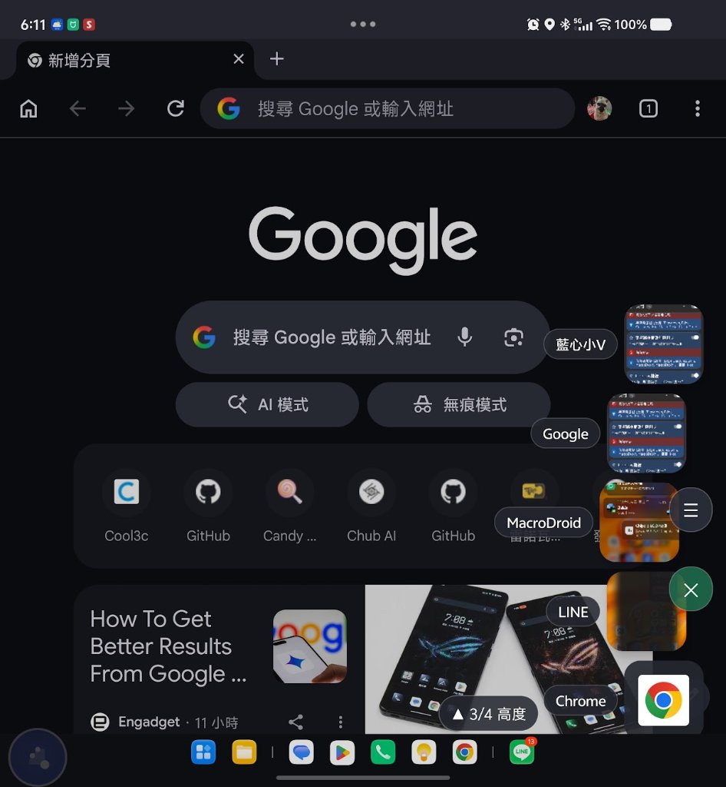

# FanRecentGesture / FanRecentSwitcher（扇形多工手勢）

**單手扇形最近任務切換器 × 邊緣手勢 × 扇形捷徑 × 透明懸浮桌面 × 模擬 Dock（未來更新）（支援手機、摺疊機與平板）**  
**One-handed fan-style recent app switcher, edge gestures, shortcut pie, transparent floating desktop, and simulated Dock (upcoming) for Android phones, foldables, and tablets.**

---

## 效果示意圖 / Preview

---

## 繁體中文說明

### 主要功能
1. **扇形多工（Tab 1）**
   - **懸浮球 & 側邊欄雙觸發**：可自由拖曳懸浮球位置，或設定左／右側邊欄手勢（向上／向下／向內／向外滑動，預設攔截系統返回手勢防誤觸），點擊或滑動即展開單手扇形最近任務輪播。
   - **雙模式任務預覽**：
     - **一般模式（免 Root / 免 Shizuku）**：透過無障礙服務即時追蹤切換過的 App，支援 Android 11+ 畫面快照縮圖（可切換純圖示）。
     - **Shizuku 增強模式**：整合 Shizuku 讀取系統級最近任務與任務縮圖，並支援一鍵授權及真分割視窗／自由小視窗。
   - **智慧排除與拖曳分割**：自動排除桌面 Launcher 與 SystemUI，支援自訂排除清單；長壓最近 App 卡片拖曳至畫面左／右（直向手機為上／下）或中央，即可開啟分割視窗或自由小視窗。
   - **多裝置與摺疊機適配**：手機、摺疊機（折疊／展開獨立記憶座標）與 8–14 吋平板自動調整扇形弧度、展開高度與展開動畫速度（無動畫 / 0.5s / 0.75s / 1s / 1.5s）。

2. **邊緣手勢（Tab 2）**
   - 支援 **左側、右側、底部** 三組獨立感應區與位置／長度／厚度／透明度微調（底部可覆蓋系統導覽條）。
   - 支援滑動、折返、斜滑、滑動停住、長壓等手勢綁定；長壓觸發時具備 **極光水波紋擴散動畫**（可自訂 0.5s～1.5s）。
   - 鍵盤彈出時自動隱藏感應區與懸浮元件，避免遮擋輸入。

3. **扇形捷徑（Tab 3）**
   - 可自訂 **3 格 / 5 格 / 7 格** 扇形捷徑輪盤，依裝置尺寸與單手操作範圍自動調整開啟高度；單擊空白處或按返回鍵即可立即收合。
   - 支援綁定 App、網站、聯絡人、媒體控制、快速設定、LINE Pay 捷徑、系統動作、模擬按鍵、透明桌面等；長壓捷徑格即可現場更換功能與圖示（內建圖示或任意 App 圖示）。

4. **透明懸浮桌面（Tab 4）**
   - 建立多個可命名的透明背景懸浮桌面，自由加入任意 App 桌面小工具（Widget），長壓拖曳移動與縮放大小。
   - 從邊緣手勢或扇形捷徑開啟時，具備從觸發點彈出與收回的回彈動畫；單擊空白處立即關閉。

5. **模擬 Dock（Tab 5 — 未來更新）**
   - *（此分頁將於未來版本更新推出）* 專為無法使用系統 Dock 或需要進階多工的裝置設計：整合左下角 **App 抽屜**（含集中展開／收回特效）、**常駐釘選 App**（長壓左右拖曳即時排序，放開確認）與 **最近使用 App**。
   - 預計支援多種底色風格（毛玻璃、泡泡框、無底色、iOS 液態玻璃、OneUI 深霧膠囊、HyperOS 霓虹框、macOS 磨砂底座）、前景縮小常駐比例調整、摺疊展開／平板專用模式，以及點擊展開／回桌面歸位回彈特效。

6. **其他貼心設計**
   - 支援 **繁體中文、簡體中文、English、日本語** 四語系即時切換。
   - 支援 **JSON 完整／分頁自選備份與一鍵還原**。
   - 支援 **應用程式內檢查更新**，權限設定按鈕點擊後自動定位捲動至本 App 項目。

---

## English Guide

### Key Features
1. **Fan Recent Switcher (Tab 1)**
   - **Floating Ball & Sidebar Triggers**: Drag the floating ball anywhere or use left/right sidebar gestures (swipe up/down/in/out with system back gesture exclusion) to launch a thumb-friendly fan carousel of recent apps.
   - **Dual Preview Modes**:
     - **Standard Mode (No Root / No Shizuku)**: Tracks recently switched apps via Accessibility Service with Android 11+ snapshot previews (or icon-only mode).
     - **Shizuku Enhanced Mode**: Reads system-level recent tasks/thumbnails and powers true split-screen & freeform window launching.
   - **Drag-to-Split & Exclude List**: Long-press and drag any recent card to split-screen (left/right on tablets/foldables, top/bottom on portrait phones) or floating freeform window.
   - **Adaptive Form Factors**: Dedicated layout and independent position memory for phones, foldables (folded vs. unfolded), and 8"–14" tablets, with customizable animation speeds (Off / 0.5s / 0.75s / 1s / 1.5s).

2. **Edge Gestures (Tab 2)**
   - Independent **Left, Right, and Bottom** trigger zones with customizable thickness, length, offset, and opacity.
   - Bind swipe, slide-and-hold, diagonal, back-and-forth, and long-press actions, featuring an **aurora water-ripple expansion animation** (0.5s–1.5s) and automatic hiding when the keyboard appears.

3. **Shortcut Pie (Tab 3)**
   - Configurable **3 / 5 / 7-slot** radial shortcut menu positioned within comfortable one-handed thumb reach; single-tap any empty area or press Back to dismiss immediately.
   - Bind apps, URLs, contacts, media controls, quick settings, LINE Pay, system actions, key events, or transparent desktops; long-press any slot to edit its action and icon on the fly.

4. **Transparent Floating Desktop (Tab 4)**
   - Create multiple named transparent overlay pages with real Android App Widgets—long-press to move or resize, and tap any empty area to close with spring-back animation.

5. **Simulated Dock (Tab 5 — Upcoming Update)**
   - *(Planned for a future update)* Floating taskbar featuring an **App Drawer** with spring-cluster animation, **Pinned Apps** (long-press and drag horizontally to reorder), and **Recent Apps**.
   - Planned features include multiple background themes (Glass, Bubble, None, Liquid Frost, OneUI Pill, HyperOS Aura, macOS Shelf), foreground auto-compact scaling, tablet/unfolded-only mode, drag-to-split/freeform, and app launch/home-return bounce animations.

6. **Localization, Backup & Updates**
   - Built-in **Traditional Chinese, Simplified Chinese, English, and Japanese** UI language switcher.
   - **Scoped JSON Backup & Restore** across Tabs 1–4 (and upcoming Tab 5) and global settings.
   - **In-app GitHub release checker** and smart permission shortcuts that auto-scroll to this app in Android Settings.

---

## 下載與安裝 / Download

> **重要公告 / Important Notice**  
> **本 GitHub 倉庫已正式移除主程式本體 APK，不再透過 GitHub 發布或更新主程式。**  
> 主程式請統一由 Google Play 商店下載安裝；目前 GitHub Releases **僅保留輔助金鑰 `FRG-Key`（`FRG-Key-v*.apk`）** 供進階使用者選用。
>
> **Notice:** The main app APK has been **removed from GitHub and is no longer updated here**. Please install the main app via Google Play. GitHub Releases now **only provides the companion key APK (`FRG-Key-v*.apk`)**.

### 參加 Google Play 測試人員（3 步驟立即下載） / Join Google Play Testing (3 Steps)
1. **加入 Google 測試群組（Join Google Group）**：  
   https://groups.google.com/g/fanrecentgesture-testers
2. **加入封閉測試計畫（Opt-in to Closed Testing）**：  
   https://play.google.com/apps/testing/com.fanrecent.switcher
3. **前往 Google Play 商店下載主程式（Download on Google Play）**：  
   https://play.google.com/store/apps/details?id=com.fanrecent.switcher

---

### 輔助金鑰（`FRG-Key`）下載與用途說明 / Companion Key (`FRG-Key`)
- **下載位置**：前往 [Releases](https://github.com/dx9901mk5/FanRecentSwitcher/releases/latest) 下載 **`FRG-Key-v*.apk`**。
- **用途說明（為何需要 `FRG-Key`？）**：
  1. **自動移除系統懸浮視窗提示通知**：主程式本身不申請通知存取權限以維持 Play 商店最小權限規範；安裝 `FRG-Key` 並授權通知存取後，可由金鑰獨立協助靜默清除系統彈出的「在其他應用程式上層顯示」提示通知。
  2. **啟用 Shizuku 增強模式**：在 `FRG-Key` 內開啟「Shizuku 增強模式」開關後，主程式即可獲得進階系統能力（精準讀取背景最近任務與縮圖、自由小視窗／左右分割強化、徹底清理系統最近任務等）。
  - *註：一般使用者若不需要上述兩項進階功能，僅需安裝 Google Play 版主程式即可完整使用，無須安裝 `FRG-Key`。*

- 本倉庫為 **純發布頁（Release-only）**，僅提供輔助金鑰 APK 下載與說明。
